# Everyarc

Math practice for a child on an iPad, and an app that tells the parent what their child showed, what's next and why. K–8 math first.

**[Try the demo](https://everyarc-demo.vercel.app)** (a fictional family; nothing is saved or sent) · [Screens](#screens) · [Decisions](decisions/) · by [Matthew "Hew" Suber](https://matthewsuber.com)

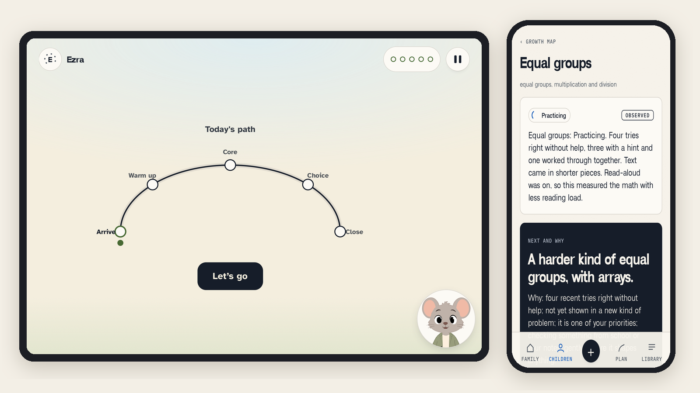

## The picture I started from

Let's say your third grader brings home a report card with "Approaching" next to multiplication. You know something is off, and the teacher knows far more than a report card has room to say. Practice apps count minutes and streaks, and none of that tells you what your child can do on their own.

Everyarc answers with evidence. A child practices on the iPad, and a skill counts as solid only when they get it right without help, 20 times out of 20, across days and different ways of showing it. The parent reads what that work showed, in plain sentences that cite it, and sets the direction: what matters now, how long a day, what to leave alone.

## What I built

I built it solo, starting October 9, 2026: the product, the design and the code. Claude Code agents write and verify code alongside me. I write the specs, make the decisions and own every production change.

- **The kid app (iPad).** A child's own world. Today's path runs warm-up, core practice, the child's own pick, then a calm close and a check on how it felt. Flashboards the child builds by tapping. A ladder of help when an answer isn't there yet: try again, a hint, another way, a worked example, then a break. A sidekick (Bamboo, Clementine or Squeak, built from my character sheets) reads aloud and points at the part of the problem that matters. It never chats.
- **The parent app (phone).** What each child showed, what's next and why, and the plan: priorities, a daily target in focus blocks, and what to leave alone. Before anything reaches the iPad, the parent sees a truth line listing exactly what goes.
- **The learning engine.** A fluency gate, with Bayesian Knowledge Tracing beside it for how sure to be. More concrete when a child struggles, more variation when it's easy, spaced checks at 1, 3, 7 and 21 days, and a day's path sized to the parent's daily target.
- **The content.** 1,761 practice items across multiplication and division and fractions, in a graph of 73 skills. SymPy computes every answer key, so no key is typed by a person or written by a model. 4,174 likely wrong answers each map to feedback about that specific mix-up.
- **The backend.** Supabase. Postgres Row Level Security keeps a household's records apart from the practice side. iPads sign in anonymously and reach only their own child, through a short list of functions.

Both apps are installable web apps on Vercel. My own family has used Everyarc since October 20. It isn't open to other families yet, because an adversarial security review, an educator's review of the content, and counsel come first.

## The decisions that shaped it

**A child moves on when the work is solid, not when the time is up.** The gate is 20 of 20 first tries without help, spread across days and representations, because a shaky foundation shows up two skills later as "bad at math." Struggle gets more support and a step back to what the skill builds on. Ease gets variation and a stretch. [ADR 003](decisions/adr-003-high-support-high-performance.md)

**Pace, never norms.** No percentiles, no "behind," no grade-level labels. A parent sees their child's own pace in school-years. A validator rejects any sentence that compares a child to others, names a condition, or claims something without evidence behind it. [ADR 002](decisions/adr-002-alpha-grade-at-home.md)

**The records stay home.** Teacher emails, reports and a parent's notes never reach the practice side. Each child's plan is compiled and filtered on the way out, and refused rather than trimmed if it carries a name, a score or a condition. The parent sees a truth line generated from what actually crosses: *"This sends Ezra's learning plan: nickname, age band and grade · 2 priorities, 1 optional, 1 paused · … Nothing else."*

**AI only where it earns a parent's trust.** Reading a teacher's report is the one place a model touches a family's records. The report is read and redacted on the parent's phone, and the parent confirms what leaves. The model only maps the report's own quotes to skills, and nothing changes until the parent approves what Everyarc says it will do. No sentence a parent reads is written by a model, because a parent should be able to trace every sentence back to their child's work or the report's own words. [ADR 005](decisions/adr-005-reading-a-report.md), in progress.

**A sidekick that reads, never chats.** Kids get a character that reads in its own voice and looks at the work with them. It never claims feelings or friendship, never mentions an absence, and Everyarc claims nothing about it helping anyone learn until a pilot shows it. [ADR 004](decisions/adr-004-sidekicks.md)

**Web first.** Two installable web apps instead of two App Store apps, so a fix ships the same day and a family starts with a link. [ADR 001](decisions/adr-001-web-first.md)

## How I work on it

- **Specs before code.** A product spec, a design brief and a contract between the two apps came before the first line of code. Every change in direction gets a short decision record, like the five in [decisions/](decisions/).
- **Every promise has a test.** The amended COPPA rule, the UK children's code and UNICEF's guidance on AI for children are mapped to 46 standards. CI fails if a standard marked as met has no test behind it.
- **Verify against reality.** 291 unit and property tests, 335 database assertions, and end-to-end runs on four iPad sizes in WebKit with an accessibility check on every screen. Before I call a screen done, I look at it.

**Stack:** TypeScript, Next.js 16 · Supabase (Postgres 17, Row Level Security, pg_cron, Deno edge functions) · Vercel · Python and SymPy for content · Playwright, fast-check, pgTAP · Anthropic API (report reading) · ElevenLabs (voices, next).

## Screens

The kid app on an iPad, with Ezra, a fictional child.

| | |
|---|---|
| 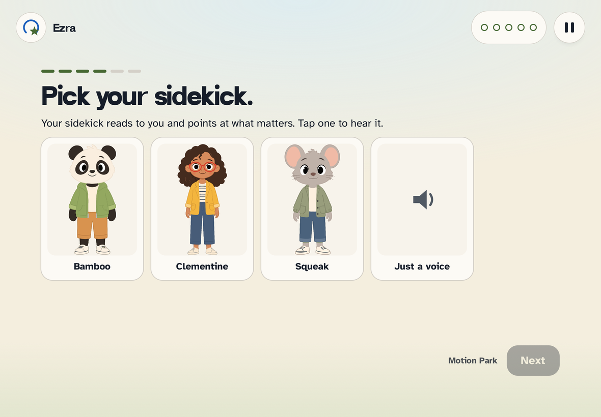 **Pick your sidekick.** Or just a reading voice. | 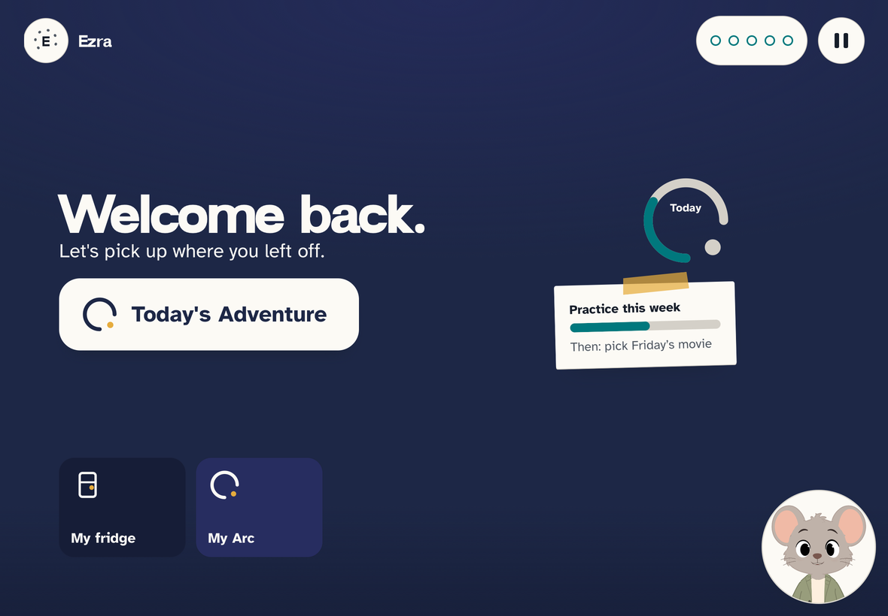 **Home.** Today's adventure, the day's arc filling, and the week's family goal. |
| 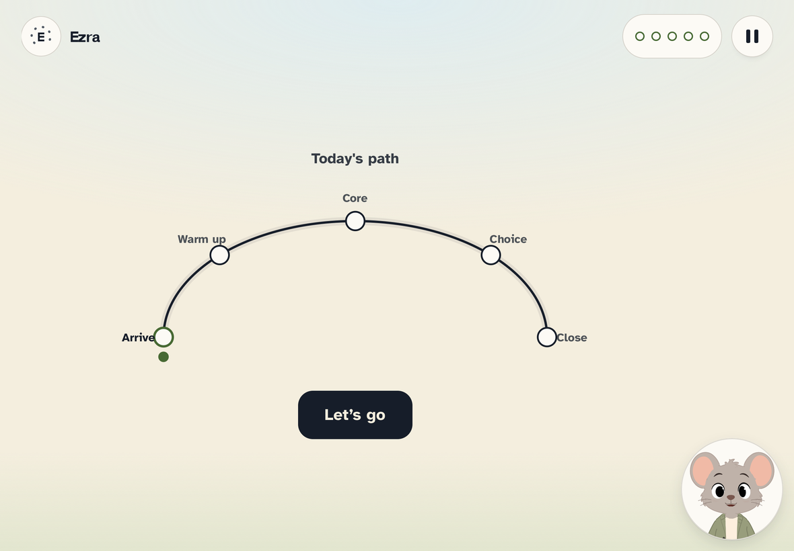 **Today's path.** Warm-up, core, your pick, close. | 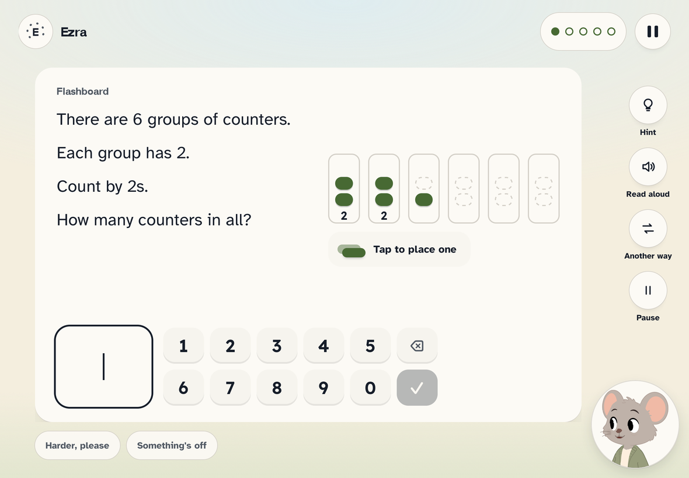 **A Flashboard.** The child builds the groups by tapping; the answer is never drawn for them. |
| 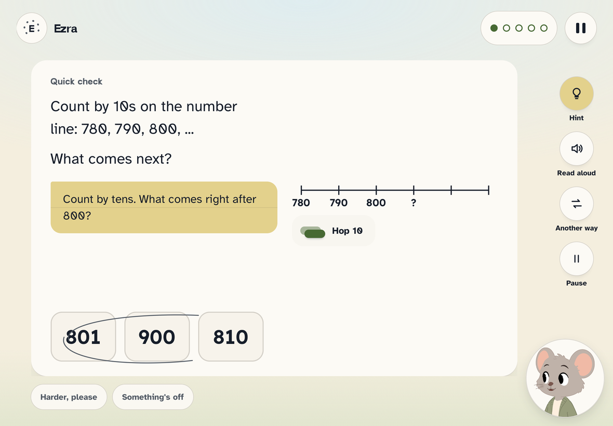 **A hint, when asked.** Offered, never forced open. | 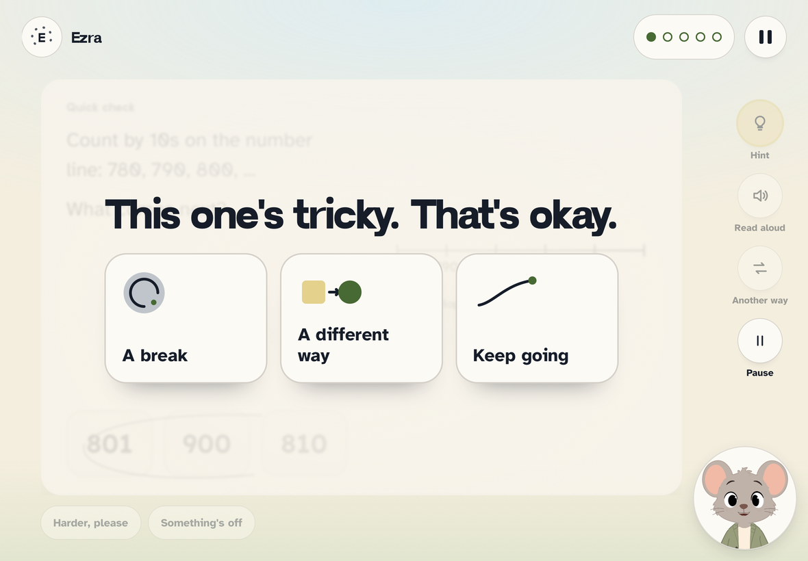 **The tricky moment.** A break, a different way, or keep going. The child chooses. |
| 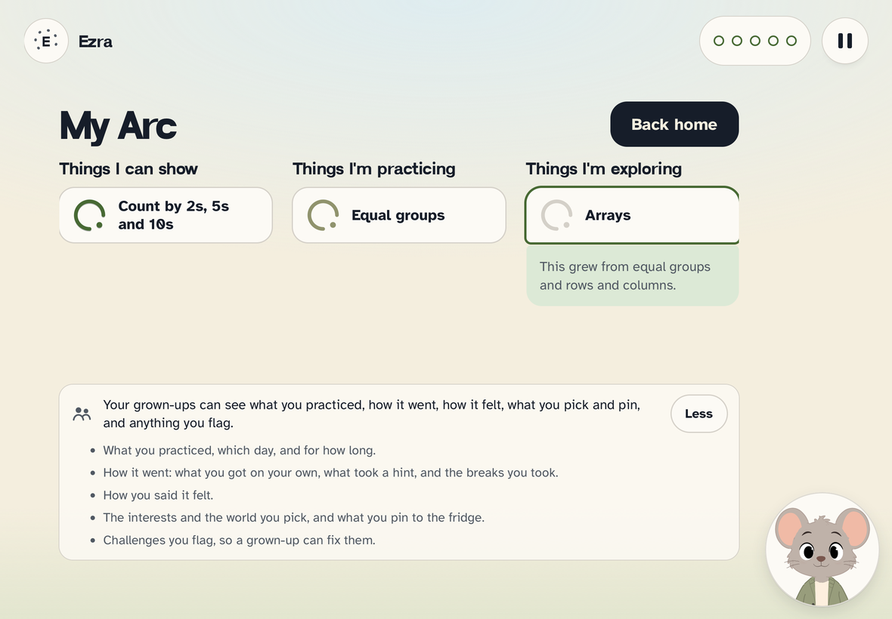 **My Arc.** What I can show, what I'm practicing, what I'm exploring, and what my grown-ups can see. | 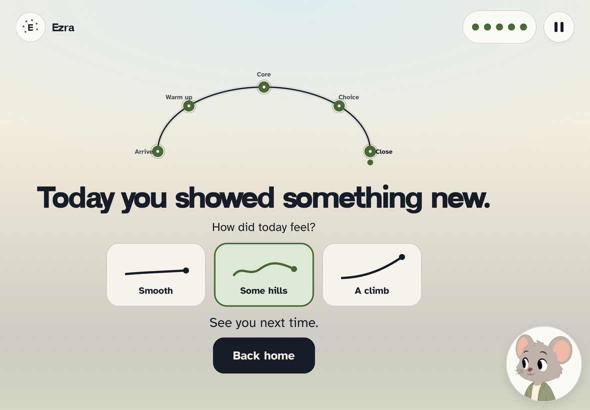 **The close.** What today showed, and how it felt. No score, no streak. |

The parent app on a phone, same family.

| | | | |
|---|---|---|---|
| 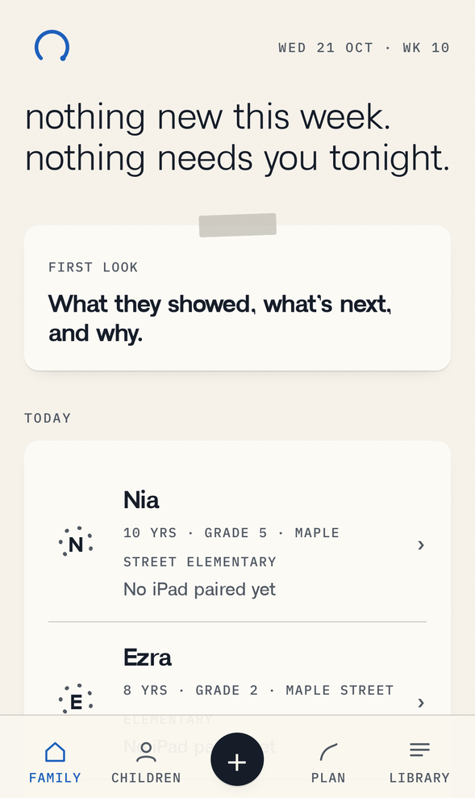 | 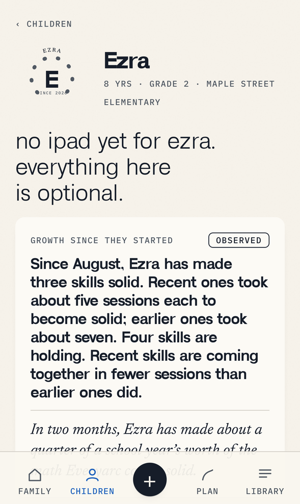 | 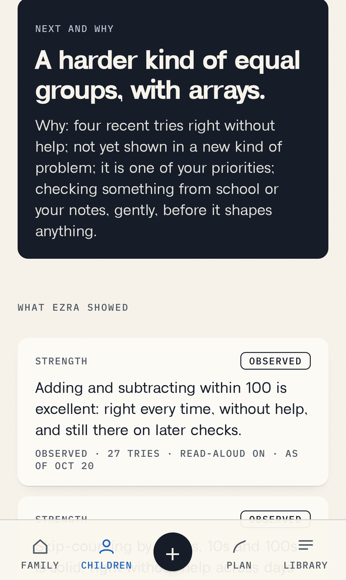 | 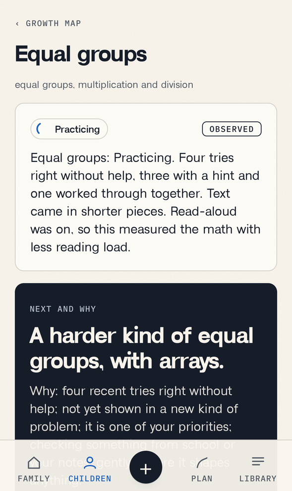 |
| **Family.** Quiet unless something needs you. | **A child.** Growth since they started, in sentences that cite the work. | **What they showed.** Each skill with its evidence. | **A skill.** What's next and why. |
| 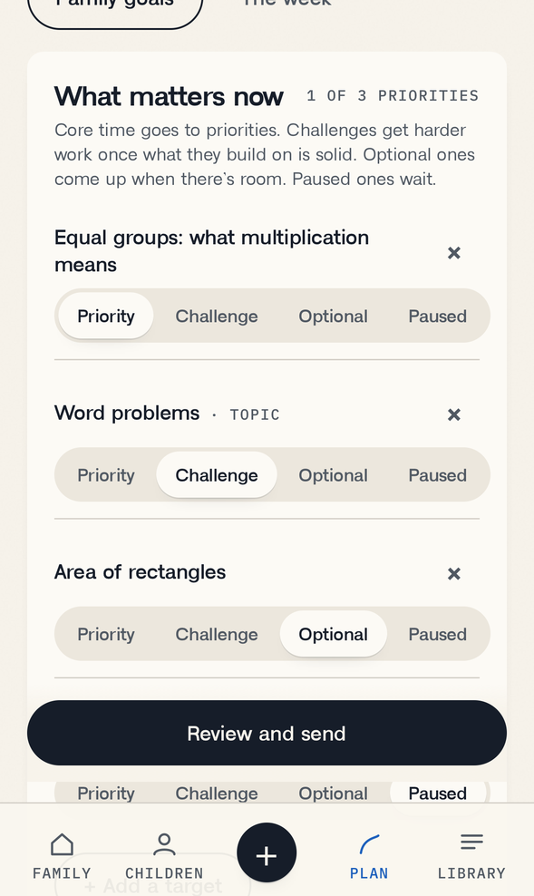 | 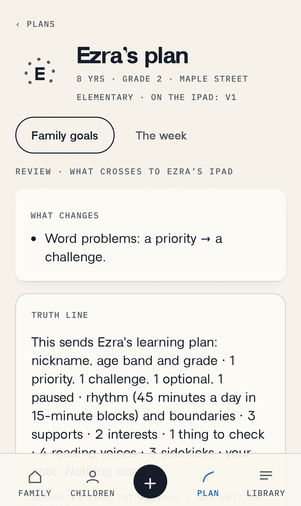 | 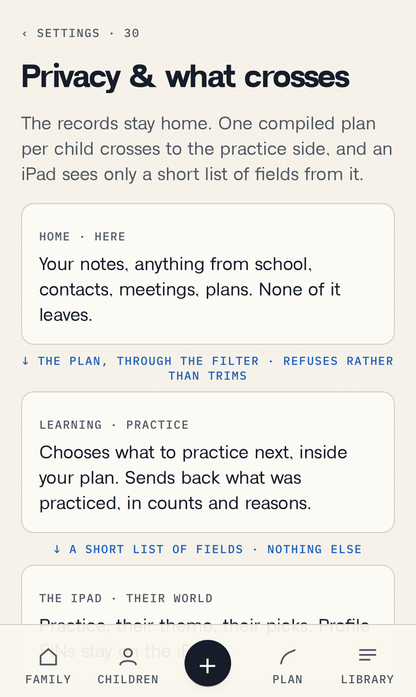 | |
| **The plan.** Priority, challenge, optional, paused. | **Review and send.** What changes, and the truth line. | **Privacy.** What stays home and what crosses. | |

## What's next

- **Reading a teacher's report.** The engine levers, redaction on the phone and the database are built and tested. The parent's screens are next.
- **Voices.** Each sidekick gets its own voice, rendered once and checked by ear.
- **A small beta,** after the security review, the content review and counsel.

The code is private. I'm glad to walk through it: [matthewsuber.com](https://matthewsuber.com).
